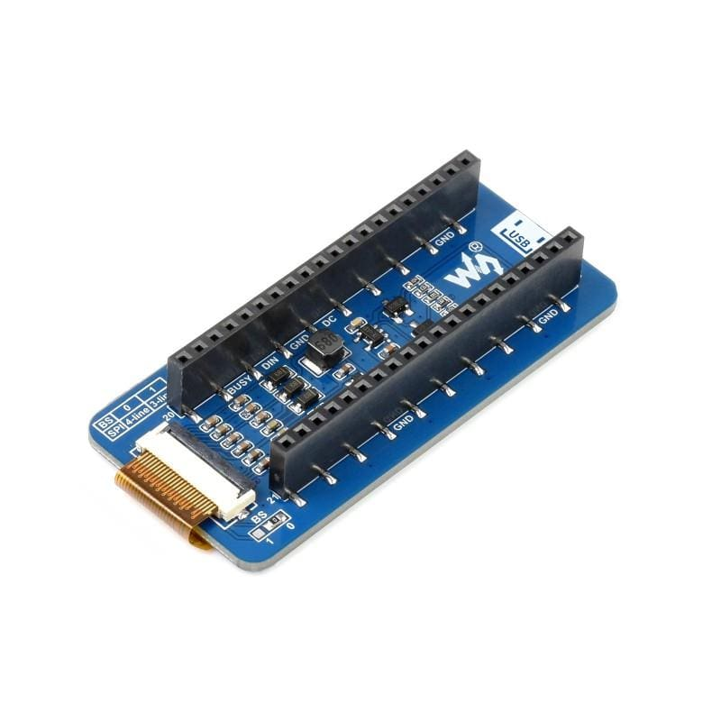
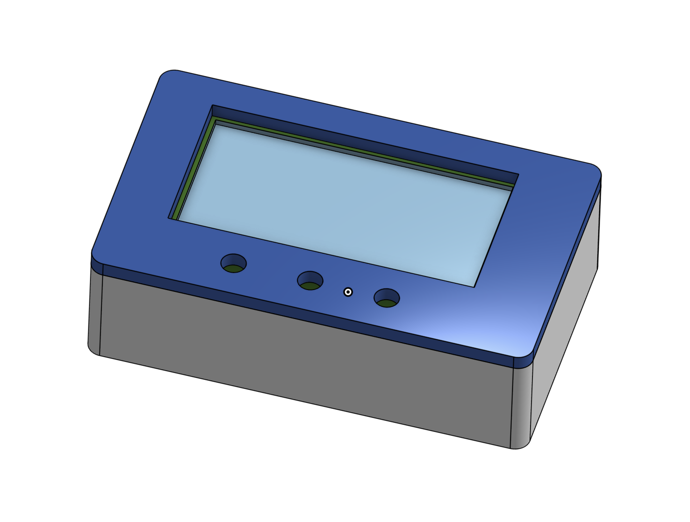

# Server-Stats

- BOM: [BOM.md](BOM.md) or [BOM.csv](BOM.csv)
- Journal: [JOURNAL.md](JOURNAL.md)
- 3D Model Files: See Enclosure.step/.stl/.x_t
- Code: [code](code)
- Enclosure link: [Onshape](https://cad.onshape.com/documents/0e2e98401547229f6d8b7911/w/038e0544fdd15a68a593150d/e/4c07c3c454585c77361754f1?renderMode=0&uiState=6ae70b505a10138744b5f000)

## What is this?
This is a small display unit that will show statistics about my Raspberry Pi and Oracle Cloud servers. It will run off USB-C, and refresh about every 5 minutes or so, using WiFi to fetch data.

## How it works
The project will use a Raspberry Pi Pico running MicroPython code, connected to a ePaper display designed for a Raspberry Pi Pico. 
Three buttons will allow user input: one to force refresh the display, one to switch between the two different servers, and one to advance through the different pages for that server.
On the two servers that are providing statistics, a Python Flask server uses the psutil module to fetch information about the server. Since both these servers run Linux, psutil has maximum compatibility. This data is then formatted on the server and written to a JSON file. 
The client, which will be the MicroPython code running on the Pico, connects to this Flask server and requests access to the JSON file stored in the data folder on the server, which is the folder that is exposed via Flask. The data is then read pre-formatted from this JSON file by the PyPico and displayed.
Currently, the client code renders a simulation of the ePaper screen in the terminal. However I have designed the code so that when I have the hardware, I can write a new class to display the information on the ePaper display, which will be interfaced with in exactly the same way as the temporary simulation class. This will mean that I only need to rewrite the code for rendering the text and none of the other code will be impacted.

I have also 3D modelled a basic enclosure which will be 3D printed at a later date. The tolerances and exact dimensions will be updated once I have the hardware.

## Images
**The ePaper display:**

**The enclosure:**
